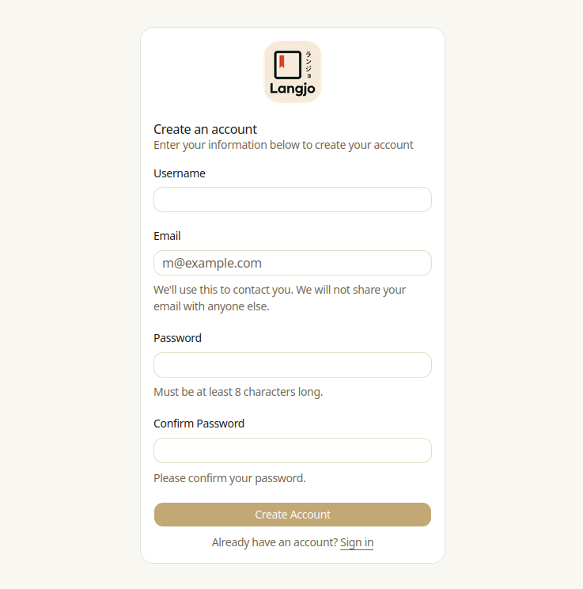
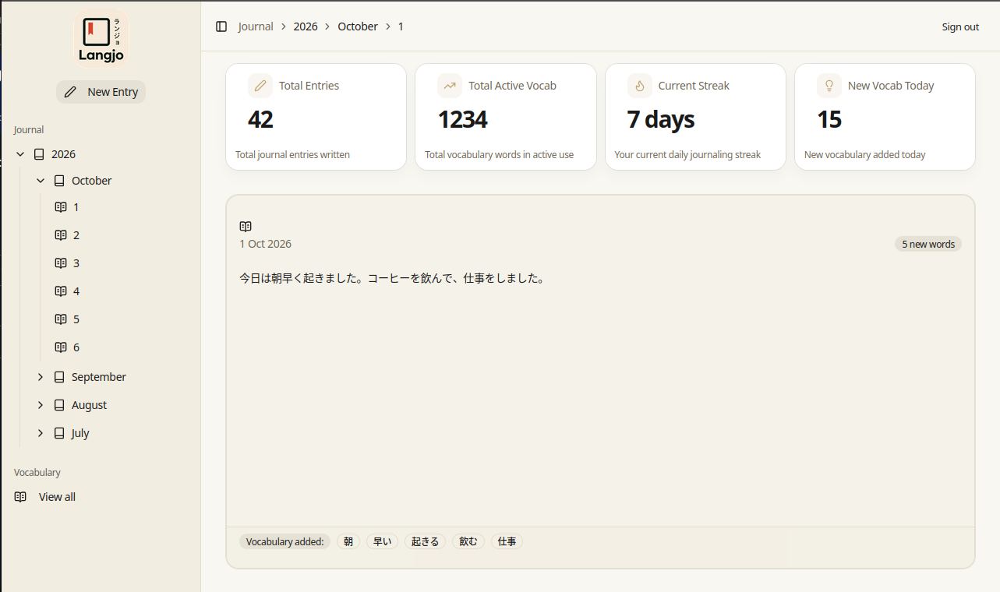
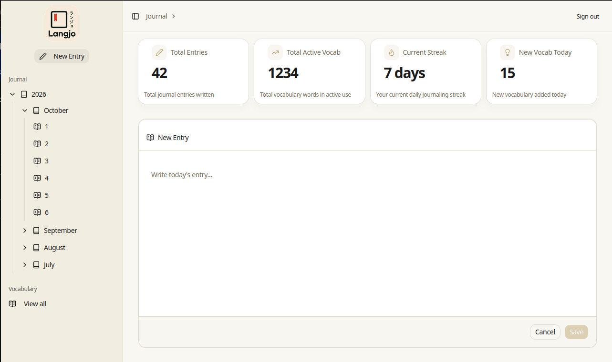
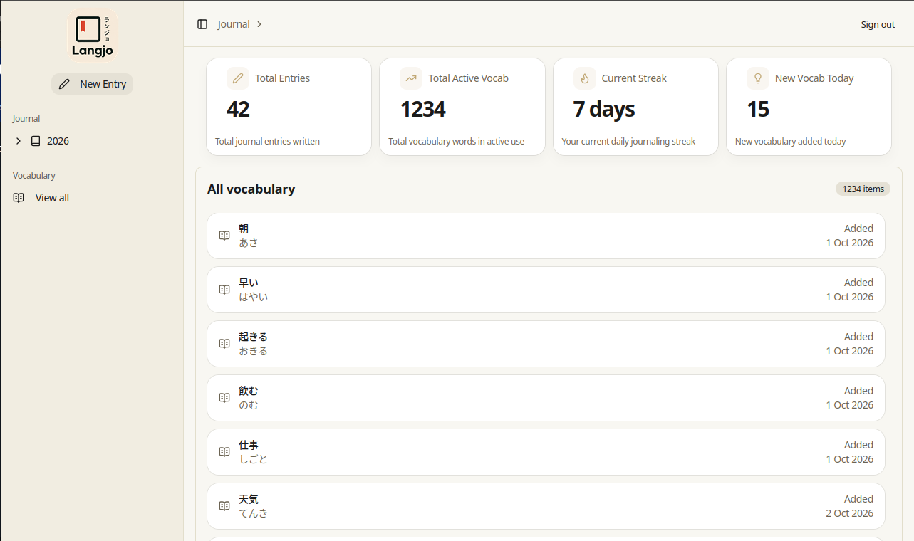
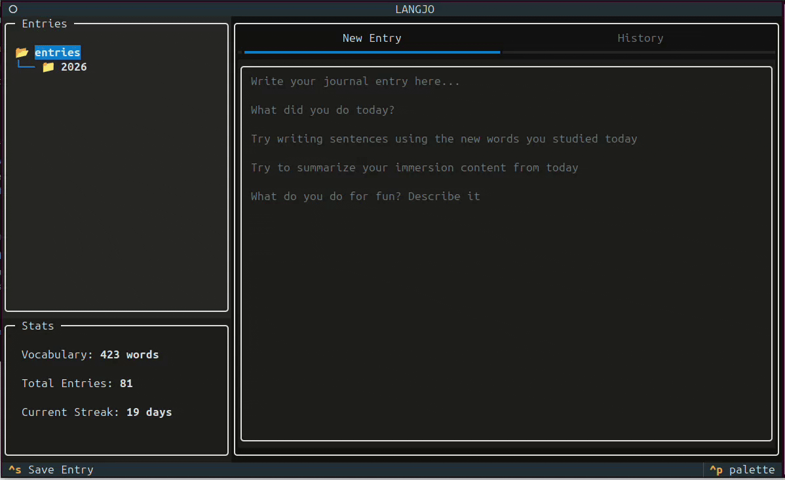

# Langjo


## Table of Contents

- [Overview](#overview)
- [File Structure](#file-structure)
- [Tech Stack](#tech-stack)
- [Features](#features)
- [Web App](#web-app)
- [Installation](#installation)
- [Run the app](#run-the-app)
- [API examples](#api-examples)
- [Textual UI](#textual-ui)
- [Database migrations](#database-migrations)
- [Roadmap](#roadmap)

## Overview

Langjo is a language-learning journaling app built around a simple idea: write daily, review naturally, and turn your journal entries into useful progress data. It combines a FastAPI backend amd a React/Vite dashboard so you can journal, track vocabulary, and monitor streaks in a few different ways.

Often the barrier to writing journals when learning a language is the writing system itself. [Japanese](https://en.wikipedia.org/wiki/Japanese_writing_system), for example, uses two syllabaries and tens of thousands of individual logographic characters. Langjo lowers this barrier and makes building a daily journaling habit attainable for learners. At the same time, it analyzes each entry to generate useful data such as vocabulary growth and writing streaks, turning daily practice into trackable progress.

## File Structure

```text
langjo/
|
├── backend/
│   ├── app/
│   │   ├── api/
│   │   │   └── routers/
│   │   │       ├── auth.py
│   │   │       ├── entries.py
│   │   │       ├── stats.py
│   │   │       └── vocab.py
│   │   ├── db/
│   │   │   ├── migrations/
│   │   │   │   └── alembic/
│   │   │   ├── models/
│   │   │   │   ├── entry_model.py
│   │   │   │   ├── user_model.py
│   │   │   │   └── vocab_model.py
│   │   │   ├── repositories/
│   │   │   │   ├── entry_repo.py
│   │   │   │   ├── stats_repo.py
│   │   │   │   ├── user_repo.py
│   │   │   │   └── vocab_repo.py
│   │   │   ├── database.py
│   │   │   └── schemas.py
│   │   ├── services/
│   │   │   ├── auth_service.py
│   │   │   ├── journal_service.py
│   │   │   ├── stats_service.py
│   │   │   ├── user_service.py
│   │   │   ├── vocab_service.py
│   │   │   └── parsing/
│   │   │       ├── base_parser.py
│   │   │       └── japanese_parser.py
│   │   ├── cli.py
│   │   ├── config.py
│   │   └── main.py
│   ├── scripts/
│   │   └── alembic_cli.py
│   └── pyproject.toml
|
├── frontend/
│   ├── textual_ui/
│   │   ├── app.py
│   │   ├── editor.py
│   │   ├── entry_tree.py
│   │   ├── history.py
│   │   ├── main.py
│   │   ├── stats_panel.py
│   │   └── styles/
│   └── web/
│       ├── src/
│       │   ├── assets/
│       │   ├── components/
│       │   ├── constants/
│       │   ├── features/
│       │   │   ├── auth/
│       │   │   ├── entriesView/
│       │   │   ├── newEntry/
│       │   │   ├── sidebar/
│       │   │   ├── statsView/
│       │   │   └── vocabView/
│       │   ├── hooks/
│       │   ├── lib/
│       │   ├── middleware/
│       │   ├── pages/
│       │   ├── services/
│       │   ├── store/
│       │   ├── types/
│       │   ├── App.tsx
│       │   ├── index.css
│       │   └── main.tsx
│       ├── package.json
│       ├── tsconfig.json
│       ├── vite.config.ts
│       └── index.html
├── tests/
├── .env
├── .gitignore
├── alembic.ini
├── example.env
├── LICENSE.txt
├── pyproject.toml
├── README.md
├── test.sh
└── uv.lock
```

## Tech Stack

- Python 3.12+
- FastAPI
- SQLAlchemy
- PostgreSQL
- Alembic
- JWT auth
- Sudachi for Japanese parsing
- React
- Vite
- TypeScript
- Tailwind CSS
- Textual (terminal UI)

## Features

- **API-first backend:** FastAPI, PostgreSQL, SQLAlchemy, JWT auth, and Alembic migrations.
- **Daily Journaling:** Write and save entries as journal content stored in the database.
- **Multiple Daily Entries:** Users can create and maintain multiple journal entries with timestamps.
- **Vocab Tracking:** Journal entries are parsed and normalized into dictionary form with [Sudachipy](https://pypi.org/project/SudachiPy/0.4.3/), and new vocabulary is saved per user.
- **Entry File Tree:** Previous entries can be retrieved and reviewed through the API or the optional Textual client.
- **Streak Tracking:** Daily entry streaks are calculated against each user’s local time.
- **Live stats:** View total vocabulary, entry count, and streak through the API and stats endpoints.

## Web App

### Login


### Signup



### Entry view



### New entry



### Vocabulary view



## Installation

```sh
git clone https://github.com/edwardpeart/langjo
cd langjo
python -m venv .venv
source .venv/bin/activate
pip install -e .
```

For the web frontend:

```sh
cd frontend/web
npm install
```

## Run the app

### API

```sh
cd langjo
source .venv/bin/activate
export PYTHONPATH=$PWD
uvicorn backend.app.main:app --host 0.0.0.0 --port 8000 --reload
```

Then open:

- http://localhost:8000/docs
- http://localhost:8000/health

### Web dashboard

```sh
cd langjo/frontend/web
npm run dev
```

Then open:

- http://localhost:5173

### Textual UI

```sh
cd langjo
source .venv/bin/activate
langjo-tui
```

## API examples

### Health check

```sh
curl http://localhost:8000/health
```

### Sign up

```sh
curl -X POST http://localhost:8000/auth/signup \
  -H "Content-Type: application/json" \
  -d '{
    "username": "demo_user",
    "email": "demo@example.com",
    "password": "secret123"
  }'
```

### Log in

```sh
curl -X POST "http://localhost:8000/auth/login" \
  -H "Content-Type: application/x-www-form-urlencoded" \
  -d "username=demo_user&password=secret123"
```

### Get current user

```sh
curl -X GET http://localhost:8000/auth/me \
  -H "Authorization: Bearer YOUR_TOKEN_HERE"
```

### View entries

```sh
curl -X GET http://localhost:8000/entries \
  -H "Authorization: Bearer YOUR_TOKEN_HERE"
```

### View vocab

```sh
curl -X GET http://localhost:8000/vocab \
  -H "Authorization: Bearer YOUR_TOKEN_HERE"
```

### View stats

```sh
curl -X GET http://localhost:8000/stats \
  -H "Authorization: Bearer YOUR_TOKEN_HERE"
```

## Textual UI

A terminal-first journaling client for quick local use, built with [Textual](https://textual.textualize.io/).

<p align="center">
  
</p>

### User prerequisites

#### Japanese input setup

To write journal entries in Japanese, install a Japanese input method.

**Linux:**

- Install `ibus-mozc` or `fcitx-mozc`

**Mac:**

- System Settings → Keyboard → Input Sources → Japanese

**Windows:**

- Settings → Time & Language → Japanese Keyboard

#### Japanese font

You will also want a font that supports Japanese characters well, such as a Kanji-friendly system font.

### Textual controls

| Key          | Action                      |
| ------------ | --------------------------- |
| **Ctrl + S** | Save entry and update stats |
| **Tab**      | Switch between UI areas     |
| **↑ / ↓**    | Navigate the file tree      |
| **Enter**    | Select folder or file       |
| **Ctrl + Q** | Quit Langjo                 |

## Database migrations

```sh
cd langjo
source .venv/bin/activate
export PYTHONPATH=$PWD
alembic -c alembic.ini current
alembic -c alembic.ini upgrade head
```

Or use the shortcut commands:

```sh
langjo-migrate
langjo-upgrade
langjo-downgrade
```

## Roadmap

- [ ] User timezones for streak accuracy
- [ ] Package and dockerize the app
- [ ] Improve the web dashboard polish and onboarding flow
- [ ] Deploy the API for demo use
- [ ] Expand multi-language support
